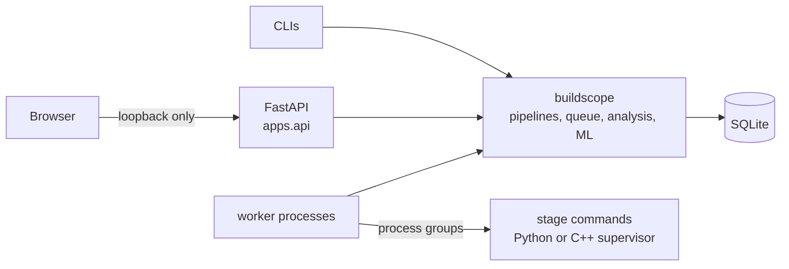

# BuildScope

BuildScope runs your CI pipelines on your own machine and keeps every attempt,
test result and benchmark sample in a local SQLite database. From that history it
answers the questions CI dashboards usually leave to you: which commit broke the
build, which tests are flaky rather than broken, which stage got slower and by
how much, and which stages are likely to fail next. It is a single-user tool: no
server to run, no account, nothing leaves the machine.

## Quickstart

Requires Python 3.12 and Git on macOS or Linux.

```bash
git clone https://github.com/liltaya/buildscope-ai.git
cd buildscope-ai
python3.12 -m venv .venv
source .venv/bin/activate
pip install .

python -m buildscope.demo seed --database data/demo.db
buildscope serve --database data/demo.db --model data/demo-model
```

Open <http://127.0.0.1:8000/dashboard>.

The demo records 22 commits of a payments service with two runs each: a lint
regression fixed three commits later, an integration-test regression that is
still open, one test that only passes on retry, a 44 % benchmark slowdown and
a failure model trained on that history. The commands in the demo pipeline are
recorded, never executed.

Each [release](https://github.com/liltaya/buildscope-ai/releases) also attaches
a wheel with a `SHA256SUMS` file; `pip install` the wheel to run BuildScope
without cloning.

## What it does

**Pipelines and execution**

- Pipelines are YAML lists of stages with dependencies, timeouts, retries, test
  reports and benchmarks. They are validated as a DAG and saved as immutable
  versions. See [docs/pipelines.md](docs/pipelines.md).
- Runs are queued with explicit approval and executed by worker processes. The
  queue supports priorities, delayed start, a global concurrency cap, one running
  job per repository and round-robin fairness between repositories.
- Each stage attempt runs in its own process group. Timeouts, cancellation and
  normal exit all kill the whole group, so no stray processes are left behind.
- Workers hold renewable leases. When a worker dies, recovery marks its job, run,
  stage and attempt as failed without replaying them.
- An optional C++20 worker supervises stages natively with the same results as the
  Python backend.

**History analysis**

- Every run records its commit, branch and dirty state. A failure on a commit
  directly after a pass on the previous commit opens a regression window, last
  good to first bad.
- pytest, CTest and GoogleTest XML is parsed and stored per attempt. Tests are
  classified as retry flaky, same-commit variability, mixed across commits,
  consistent failure or stable.
- Benchmarked stages store every timed sample. A revision counts as a slowdown
  only if its median rose by at least 20 % and by more than three times the
  combined median absolute deviation.

**Failure prediction**

- History exports to a dataset where each example only sees runs that finished
  before it was queued, with chronological splits grouped by run.
- Features are a stage's own track record: its failure, timeout and
  retry-recovery rates, the share of its last five runs that failed, its last
  result, its test failure rate and the Git worktree state. Counts, calendar
  fields and stage identity are left out: under a chronological split they let
  a model learn when a run happened rather than whether it fails.
- A logistic regression is trained and evaluated on a holdout against a
  constant-prior baseline.
- The dashboard shows per-stage scores from a model you trust, next to that
  model's holdout ROC AUC. Scores are uncalibrated rankings, not probabilities.

**Dashboard**

A dense, read-only view for one pipeline version:

| Panel | Shows |
|---|---|
| Summary | runs, pass rate, open regressions, flaky tests, worst-trending stage |
| Run matrix | stages by runs; each cell split into attempts, with retries marked |
| Pipeline graph | stage dependencies with last status and risk or failure rate |
| Stage failure risk | model scores against the decision threshold |
| Commits | every commit's latest outcome and the regression windows |
| Unstable tests | classification, failure rate and the last 20 outcomes |
| Benchmarks | median and MAD per revision, with slowdown markers |

Every panel explains what to configure when it has no data. Every chart works
with the keyboard, and tooltips show exact values.

## Running your own pipelines

```bash
buildscope serve --database data/buildscope.db
```

Register a repository and save a pipeline through the API, then queue and run it:

```bash
python -m buildscope.workers.cli --database data/buildscope.db \
  preview --repository <id> --pipeline ci --version 1
python -m buildscope.workers.cli --database data/buildscope.db \
  enqueue --repository <id> --pipeline ci --version 1 --approve
python -m buildscope.workers.launcher --database data/buildscope.db --workers 2
```

The full walkthrough, including the C++ backend and model training, is in
[docs/pipelines.md](docs/pipelines.md).

### Configuration

| Variable | Default | Purpose |
|---|---|---|
| `BUILDSCOPE_DATABASE_PATH` | `data/buildscope.db` | SQLite database used by the API |
| `BUILDSCOPE_ENABLE_LOCAL_DASHBOARD` | off (`buildscope serve` turns it on) | serve `/dashboard` |
| `BUILDSCOPE_ENABLE_LOCAL_PREDICTIONS` | off | serve failure scores |
| `BUILDSCOPE_TRUSTED_MODEL_DIR` | unset | model directory for predictions |

`buildscope serve --model DIR` sets the last two for you.

## Architecture



Components, the run lifecycle, the data model, scheduling rules and the SQLite
locking strategy are described in [docs/architecture.md](docs/architecture.md).

## Security model

BuildScope assumes one trusted user on one machine.

- The server binds only to loopback. Every route, including the write endpoints,
  rejects non-loopback clients, foreign `Host` headers and cross-origin requests,
  so web pages in your browser cannot drive it.
- The API never runs commands. Runs start only from `enqueue --approve`, and the
  dashboard and prediction endpoints are read-only.
- Commands are argument lists executed without a shell.
- Test XML is parsed with DTDs and entities disabled.
- Models are loaded only from directories you own that no one else can write, and
  only if their checksum matches.

**Limitations**

- Stages are not sandboxed. An approved pipeline can do anything your account can.
- There is no authentication. Do not expose the port through a proxy or tunnel.
- If a worker is killed, recovery fails its job but does not stop the stage process
  it was running.
- Failure scores are uncalibrated, and models trained on short histories can rank
  poorly; check the holdout ROC AUC shown beside them.
- Low-priority jobs can be starved by a constant stream of high-priority jobs.
- macOS and Linux only.

See [SECURITY.md](SECURITY.md) for the full model and how to report a vulnerability.

## Development

```bash
python3.12 -m venv .venv
source .venv/bin/activate
pip install -e ".[dev]"

ruff check . && ruff format --check .
mypy buildscope apps tests

cmake -S . -B build/dev -DCMAKE_BUILD_TYPE=Release
cmake --build build/dev
ctest --test-dir build/dev --output-on-failure

pytest
```

Tests that need the C++ worker look for `build/*/cpp-worker/buildscope_cpp_worker`
or `$BUILDSCOPE_CPP_WORKER` and skip with build instructions when it is missing.

CI runs on Ubuntu and macOS with Python 3.12:

- Ruff, mypy, a CMake build with CTest, and pytest. The C++ worker is required in
  CI, not skipped.
- A wheel and sdist build, then a clean install outside the source tree that
  starts the server and checks `/health`, `/health/ready` and `/dashboard`.
- `pip-audit` against the resolved dependencies.
- gitleaks over the full Git history, plus a check that no database, model or
  secret file is tracked.

## Releasing

Tags `vX.Y.Z` trigger `.github/workflows/release.yml`. It checks that the tag
matches `pyproject.toml`, reruns `python -m buildscope.release preflight`, builds
the wheel and sdist, writes `SHA256SUMS`, and publishes a GitHub release with the
changelog section as notes. The checklist and backup procedures are in
[docs/release.md](docs/release.md).

## License

MIT. See [LICENSE](LICENSE).
