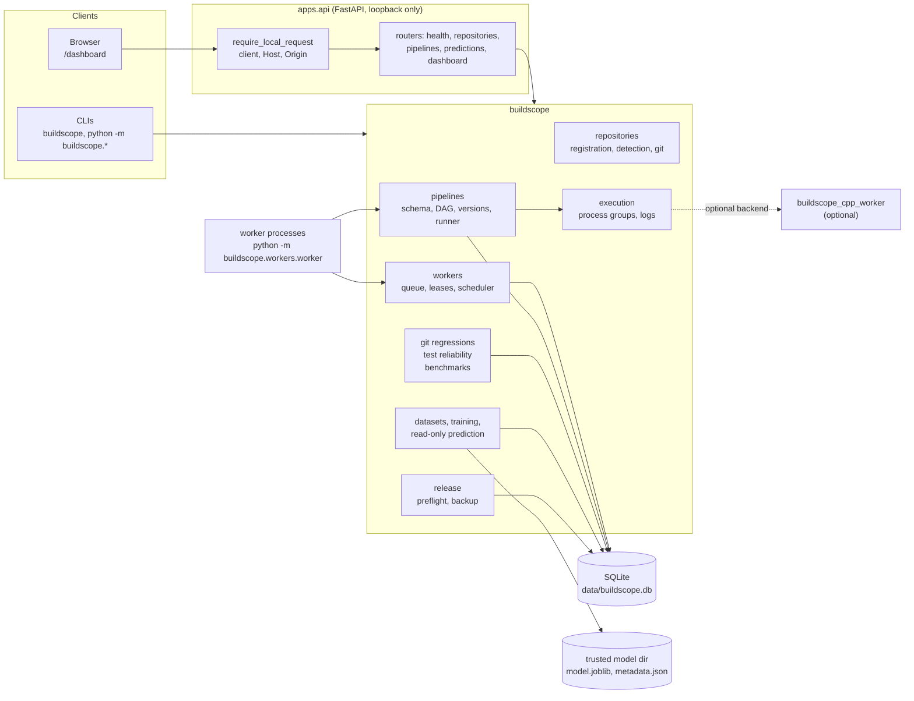
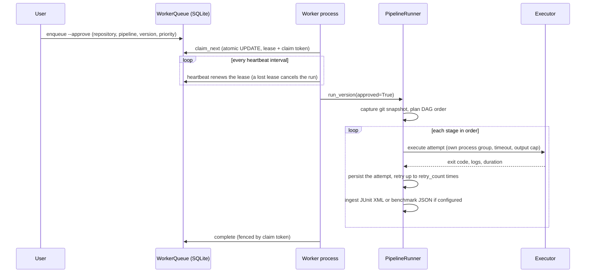
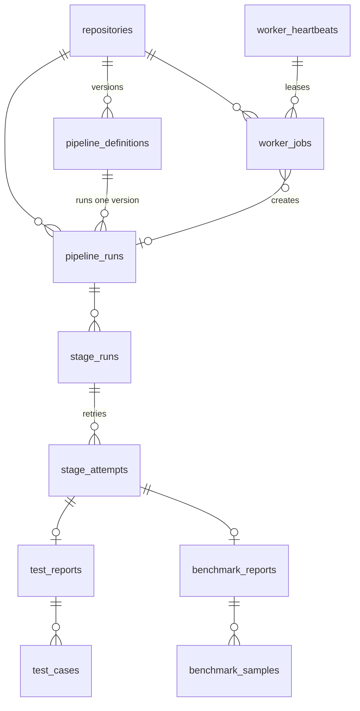

# Architecture

BuildScope is a single Python package (`buildscope`), a FastAPI application
(`apps.api`) and an optional C++20 stage worker (`cpp-worker`). All state lives in
one SQLite database. Everything runs on one machine for one user.

## Components

The API never executes stages. Pipelines run only in worker processes, and only
after a job has been enqueued with explicit approval.

## Run lifecycle

If a worker dies, its lease expires. `recover_stale` checks that the worker's
heartbeat is old and its PID is gone, then marks the job, run, running stage and
running attempt `FAILED`, marks unstarted stages `BLOCKED`, and never replays the
job.

## Data model

Pipeline definitions are immutable: saving a pipeline with an existing name
creates version `n + 1`; earlier versions and the runs that reference them never
change. Each run stores the commit SHA, branch, dirty flag, commit time and
subject captured just before it starts.

The schema is managed by Alembic migrations shipped inside the package
(`buildscope/database/migrations`). The API upgrades the database on startup, and
`tests/database/test_migrations.py` fails if the ORM models and migrations drift.

## Execution

`buildscope.execution.execute_command` starts each stage with
`start_new_session=True`, so the stage and everything it spawns share one process
group. On timeout or cancellation the group receives SIGTERM, then SIGKILL after
0.4 s. After a normal exit the group is also killed, so background processes a
stage leaves behind do not outlive it. Output is streamed to per-attempt log files
and capped at `max_output_bytes`.

The C++ worker (`cpp-worker/src/main.cpp`) implements the same contract natively:
it puts the stage in its own process group, enforces the timeout and output caps,
and reports one line, `BSCOPE1<TAB>outcome<TAB>exit<TAB>stdout-truncated<TAB>stderr-truncated`.
Arguments arrive through a length-prefixed file, so no shell ever parses them.
`tests/pipelines/test_backend_parity.py` runs one pipeline on both backends and
requires identical persisted results.

Neither backend is a sandbox. Stages run with the user's permissions.

## SQLite concurrency

Every connection enables `foreign_keys` and a 30 s `busy_timeout`, and every
transaction starts with `BEGIN IMMEDIATE`. A deferred transaction that reads and
then writes must upgrade its lock, and SQLite fails that upgrade immediately when
another writer holds the lock rather than waiting. Taking the write lock up front
turns contention between workers into an ordinary wait.

## Scheduling

`claim_next` selects one job with a single `UPDATE ... WHERE id = (subquery)`:

1. only `QUEUED` jobs whose `not_before` has passed;
2. never a repository that already has a `RUNNING` job;
3. never more than `max_running_jobs` running jobs in total;
4. ordered by priority (0 to 9, higher first), then the repository served least
   recently, then queue time, then job ID.

Step 4's second key gives round-robin fairness across repositories at equal
priority. There is no aging: a steady stream of high-priority work can starve
lower priorities.

## Analysis

| Analysis | Input | Rule |
|---|---|---|
| Git regressions | clean runs on a branch, same pipeline version | a `FAILED` run on commit B directly after a `SUCCEEDED` run on a different commit A gives the window A to B |
| Test reliability | parsed JUnit, CTest and GoogleTest cases | retry recovery, then same-commit variability, then mixed results across commits, then consistent failure or stable pass |
| Benchmarks | `process_wall_time` samples per commit | slowdown when the median rises by at least the threshold (default 20 %) and by more than 3 x the summed MADs |
| Failure dataset | first attempt of each stage | features are the stage's failure, timeout and retry-recovery rates, its last five results, its test failure rate and the Git state, from runs that finished before the target run was queued; splits are chronological and grouped by run |

## Predictions

Training (`buildscope.ml.training`) fits a scikit-learn logistic regression on an
exported dataset and writes `model.joblib`, `metadata.json` and `metrics.json`,
including a constant-prior baseline on the same holdout.

Loading a model unpickles it, so `TrustedFailureModel.load` refuses a model
directory or file that is a symlink, owned by another user, or writable by group
or others. It hashes the bytes it is about to unpickle and compares them with
`metadata.json`. The API caches a loaded model by file signature and re-verifies
it when either file changes.

Predictions read history and call `git` to describe the working tree; they never
enqueue, run or write anything. Scores are not calibrated probabilities, and the
dashboard shows the model's holdout ROC AUC beside them.

## Dashboard

`/dashboard` serves three static files with a `default-src 'self'` Content
Security Policy. `app.js` builds all charts as SVG with no library and inserts
untrusted text only through `textContent`. Its data comes from three read-only
endpoints:

| Endpoint | Returns |
|---|---|
| `GET /dashboard/api/overview` | repositories, pipeline versions with run counts and last status |
| `GET /dashboard/api/insights` | summary, run matrix, stage graph, commits, regression windows, unstable tests, benchmark series |
| `GET /dashboard/api/predictions` | per-stage scores, threshold and holdout metrics, or why predictions are off |

Panels look at the last 100 runs of one pipeline version; the matrix shows the
last 30.
